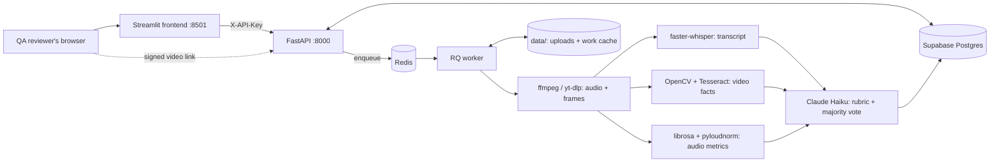

# Humaniti AI

Rates recorded online chess classes (Eight Times Eight) as Excellent, Good, Average, Weak or Known quality
issues, with timestamped evidence: code measures facts from the video and audio, Claude Haiku reads the
transcript and applies the rubric, and QA reviews the suggested label next to the recording.

## Architecture



A video is identified by its SHA-256; the same video under the same rubric and model is never processed twice.

## Tech stack

- **Backend:** Python 3.12, FastAPI, SQLAlchemy + Alembic on Supabase Postgres, Redis + RQ worker.
- **Pipeline:** ffmpeg, yt-dlp, faster-whisper (`small.en`, int8, CPU), OpenCV (headless), Tesseract OCR,
  librosa, pyloudnorm.
- **LLM:** Anthropic SDK, `claude-haiku-5-5`, prompt caching, pydantic-validated output.
- **Frontend:** Streamlit + requests, in its own image without secrets.
- **Ops:** Docker Compose (redis, api, worker, frontend), pytest, ruff.

## Quick start with Docker

1. **Docker Desktop with WSL 2.** On Windows run `wsl --install`, reboot, then `winget install Docker.DockerDesktop`
   and keep *Use the WSL 2 based engine* on. Check with `docker run --rm hello-world`.
2. **Supabase.** Create a project (region Mumbai), then *Connect → Session pooler* and copy the URI. Change the
   scheme to `postgresql+psycopg://` and URL-encode special characters in the password. Use the session pooler
   (port 5432); it works on IPv4 networks.
3. **Anthropic.** Create a key at console.anthropic.com and add credit. `LLM_MODEL` defaults to `claude-haiku-5-5`.
4. **`.env`.** Copy `.env.example` to `.env` and fill in `DATABASE_URL`, `ANTHROPIC_API_KEY` and `API_KEY` (a
   shared secret between the frontend and the API:
   `python -c "import secrets; print(secrets.token_urlsafe(32))"`). `.env` is never committed, and Compose passes
   only `API_KEY` to the frontend container, never the rest of `.env`.
5. **Run:**

```bash
docker compose up -d --build
docker compose run --rm --no-deps api alembic upgrade head
curl http://localhost:8000/health
```

The frontend is at http://localhost:8501:

- **New evaluation:** upload or link, live progress, then the review report.
- **Tutor history:** past classes, with QA's label where reviewed, and criteria repeatedly not met.
- **Agreement:** how often QA kept the suggested label and the verdicts of the criteria QA checked, over time.

All dates and times are shown in IST. Follow the worker with `docker compose logs -f worker`; it logs each stage
with a timestamp. The Whisper model downloads into `models/` on first use.

**Public API URL.** The report's player streams the recording from the API in the reviewer's browser, through a
signed link that expires after 10 minutes. `PUBLIC_API_URL` (default `http://localhost:8000`) is the address that
browser reaches the API at; set it when the app runs on another machine.

## Local run

| Tool | Windows | Check |
|---|---|---|
| Python 3.12 | `winget install Python.Python.3.12` | `py -3.12 --version` |
| ffmpeg | `winget install Gyan.FFmpeg` | `ffmpeg -version` |
| Tesseract 5 | `winget install UB-Mannheim.TesseractOCR`, add `C:\Program Files\Tesseract-OCR` to PATH | `tesseract --version` |

On Linux: `apt install ffmpeg tesseract-ocr`. The Docker image already contains both.

```bash
py -3.12 -m venv .venv
.venv\Scripts\activate
pip install -r requirements-dev.txt
alembic upgrade head
```

RQ forks a process per job, which Windows does not support, so the **worker always runs in Docker**, next to
Redis. The API runs either in Docker or locally:

```bash
docker compose up -d --build redis worker
.venv\Scripts\uvicorn app.api.main:app --port 8000
set API_KEY=<same as .env> && .venv\Scripts\streamlit run frontend\streamlit_app.py
```

Compose publishes Redis on `localhost:6379`, so `REDIS_URL` in `.env` stays `redis://localhost:6379/0` for an
API run locally; the compose services use `redis://redis:6379/0`. The frontend reads only `API_URL` (default
`http://localhost:8000`) and `API_KEY` from its environment.

Both share `./data`. Uploads are saved as `data/uploads/<sha256>.mp4` and stored in the database as a relative
path, so the worker in the container finds a video uploaded through a local API.

Tests and lint:

```bash
pytest
ruff check --fix . && ruff format .
```

## QA review mode

Humaniti AI is a QA assistant, not an auto-labeller (decision 32): on 10 calibration videos it agreed with QA on
background, homework and individual attention, but not on rapport, new joiners and energy, which decide most
labels. Each report therefore shows:

- **Suggested label** with a confidence: *high* when no "Needs QA check" verdict could change the label on its
  own (e.g. K1 no background), *low* otherwise, naming the criteria it depends on.
- **Measured** (background, camera, lighting, homework, individual attention) and **Needs QA check** (rapport,
  new joiners, energy, conclusion, clarity, extras), each with its verdict, evidence and suggestion.
- **The recording**: every timestamp in the evidence is a ▶ button that starts the video there.
- **QA review**: accept the suggested label or choose another, tick each "Needs QA check" criterion checked in
  the recording, optionally override verdicts, comment, and sign with the reviewer's name. Sending a review again
  replaces it.

Criterion agreement counts only the criteria QA ticked as checked (or gave a verdict): a criterion nobody looked at
is not counted as agreed. The Agreement page shows how many criteria were checked next to each figure.

Once reviewed, the QA label and overrides are what tutor history and the repeated-issue rule (K3, Known quality
issues) use; the system's own label and verdicts stay stored for the Agreement page.

## API

Every route except `/health` and the signed video link needs the header `X-API-Key` set to `API_KEY` from `.env`;
otherwise it answers 401.

| Method | Path | |
|---|---|---|
| `POST` | `/evaluations` | Multipart form: `tutor_name` and either `file` (mp4, mkv, webm) or `url`, plus `batch_id`, `class_date` (YYYY-MM-DD) and `level`. For uploads, missing ones are read from the file name. |
| `GET` | `/evaluations/{id}` | Status (`pending`, `processing`, `done`, `failed`), stage, error, label and the full result. |
| `GET` | `/evaluations/{id}/transcript` | Transcript segments `[{start, end, text}]`. |
| `GET` | `/evaluations/{id}/video-url` | `{url, expires}`: a link to the recording, signed with an HMAC token and valid for 10 minutes. |
| `GET` | `/evaluations/{id}/video?expires=…&token=…` | The recording, for the browser's player: needs the token instead of the API key (403 if invalid or expired) and answers byte ranges, so the player can seek. |
| `POST` | `/evaluations/{id}/review` | JSON `{qa_label, qa_overrides: {criterion: verdict}, qa_checked: [criterion], qa_comment, reviewer}`; only for finished evaluations; `qa_checked` takes "Needs QA check" criteria only. |
| `GET` | `/agreement` | Label agreement, and agreement on the criteria QA checked, by IST review week. |
| `GET` | `/tutors/{name}/history` | The tutor's finished evaluations and repeated issues. |
| `GET` | `/health` | Database and Redis check. |

```bash
curl -H "X-API-Key: $API_KEY" -F tutor_name="Demo Tutor" -F "file=@B435 Intermediate Part  - 2026-07-25(good).mp4" http://localhost:8000/evaluations
curl -H "X-API-Key: $API_KEY" -F tutor_name="Demo Tutor" -F url=https://... -F batch_id=B435 -F class_date=2026-07-25 -F level=Intermediate http://localhost:8000/evaluations
curl -H "X-API-Key: $API_KEY" http://localhost:8000/evaluations/1
```

Stages: `queued`, `downloading` (links only), `extracting`, `transcribing`, `video_facts`, `audio_metrics`, `llm`,
`saving`, then `done` or `failed`.

- **The same video again** (same SHA-256, rubric version and model) returns the stored result at once, with no
  new LLM cost. A link that was already evaluated is returned without downloading it. A new link is downloaded
  and hashed by the worker; if that video was evaluated before, its result is copied.
- **Failures** end as `failed` with a reason, e.g. `Failed while downloading: could not download the link (...)`.
  Covered: bad link, no audio stream, video longer than 3 h (`MAX_VIDEO_S`), Anthropic API errors. Sending the
  same file or link again re-runs it and reuses the audio, frames and transcript already on disk.
- After an evaluation is saved, its frames and `audio.wav` are deleted; `data/work/<sha256>/transcript.json` and
  `facts.<hash>.json` are kept. The hash covers the video and audio thresholds in `app/config.py`, so changing
  one measures the facts again on the next run.
- **Majority vote.** Claude rates each class once. When one transcript-judged verdict crossing the gap line
  (`partly` ↔ `not_met`) would change the label, it rates the class again; a third run is made only when the
  first two disagree on a gap. Each verdict is taken by majority and code recomputes the label. `runs_used`
  (1 to 3) and `retry_count` are stored per evaluation.
- Tutors are matched case- and space-insensitively and shown as first typed ("Tutor B482").

## Disk cleanup

Videos and work folders take about 100–250 MB per class. `scripts/cleanup.py` deletes uploads and work folders
not used for `RETENTION_DAYS` (default 30; set it in `.env`), but never a video whose evaluation is still running
or waiting for QA review, because the report plays it. The evaluations stay in the database, so reports
and tutor history are unaffected and the same video still returns its stored result. Re-running a failed
evaluation, or evaluating a video again under a new rubric, then needs the file uploaded again. Uploading a
video that is already stored counts as using it.

```bash
python -m scripts.cleanup --dry-run    # list what would be deleted
python -m scripts.cleanup
docker compose run --rm --no-deps worker python -m scripts.cleanup    # from the worker image instead
```

Run it weekly, for example from Windows Task Scheduler or cron.

## Evaluating a folder

`scripts/evaluate_folder.py` runs every video in a folder through the pipeline and compares the label with the
QA label in the file name. It reuses cached transcripts and facts, writes nothing to the database, ignores tutor
history and saves the verdicts to `data/calibration/<time>.json`.

```bash
python -m scripts.evaluate_folder samples
```

It prints each video's label, rule, runs, cost and time, a confusion matrix, and the total and average cost.

**Adding holdout videos.** Keep them in their own folder (e.g. `holdout/`, ignored by git like `samples/`):

1. Name each file like the QA exports, with the QA label in brackets after the date:
   `B501 Intermediate Part  - 2026-10-01(good).mp4`. Accepted labels: excellent, good, average, weak, quality issue.
2. Add `holdout/tutors.json` mapping each file name to its tutor: `{"B501 Intermediate Part  - 2026-10-01(good).mp4": "Demo Tutor"}`.
   The tutor name is needed to recognise the tutor's camera-off name card.
3. Run `python -m scripts.evaluate_folder holdout`. The first run transcribes each video (about 8 min per hour of
   class on CPU); later runs only pay for the LLM.

Judge changes on videos the rubric was not tuned on: `samples/` was used to write the rules, so it overstates
accuracy.

## Results

With `claude-haiku-5-5`, about ₹0.4–0.5 per video:

- **Training (`samples/`, 5 videos the rubric was written on): 4/5**, stable across passes. B482 comes out
  Average where QA said Weak: its camera-off is 14 s, below the 30 s rule.
- **Holdout (5 unseen videos): 1/5.** Only the Known quality issues class matched; the others missed by one or
  two labels in both directions.

Criterion-level agreement with QA's written feedback on all 10 videos (unmentioned criteria not scored):

| criterion | QA comments | agree | partly | disagree | reliable? |
|---|---|---|---|---|---|
| background | 8 | 8 | 0 | 0 | yes (measured) |
| homework | 6 | 6 | 0 | 0 | yes, but QA does not always count it |
| individual attention | 6 | 5 | 1 | 0 | yes |
| rapport | 6 | 4 | 0 | 2 | mostly |
| energy / pleasantness | 5 | 1 | 4 | 0 | direction right, but Haiku stops at partly where QA counts a gap |
| new joiners | 3 | 0 | 2 | 1 | no |
| camera | 2 | 1 | 0 | 1 | 14 s off is below the rule, QA counted it |
| lighting | 1 | 1 | 0 | 0 | too few comments |
| conclusion | 1 | 0 | 1 | 0 | too few comments |
| clarity | 1 | 0 | 1 | 0 | too few comments; QA meant video clarity |

Details per video are in [docs/SPEC.md](docs/SPEC.md#results-phase-8-rubric-91957f7d-claude-haiku-5-5-3-passes-over-samples).

## Limitations

- The label is a suggestion. The process criteria that decide Weak (rapport, new joiners, conclusion) and the
  energy judgement disagree with QA too often to auto-label; that is why every report goes through QA review.
- 10 labelled videos is a small sample, and QA's own labels are not always consistent on the same gap.
- English only (`small.en`); transcription takes about 8 min per hour of class on CPU.
- Camera-off and name-card detection rely on the video-call layout and on the tutor name typed matching the name card.
- The worker needs Docker on Windows (RQ forks).

## Privacy

No recordings, audio, transcripts, facts or real tutor and student names are stored in this repository:
`data/`, `samples/`, `holdout/`, `models/`, `tutors.json` and `.env` are git-ignored. Tutors in the rubric's
reference feedback are batch labels ("Tutor B491"), example quotes are invented, and tests use fictional names.
The screenshots are redacted: names and the evidence column are pixelated. Logs never contain transcript text or
student names.

The 8×8 logo templates in `app/assets/` belong to Eight Times Eight and are included only for the background check.

